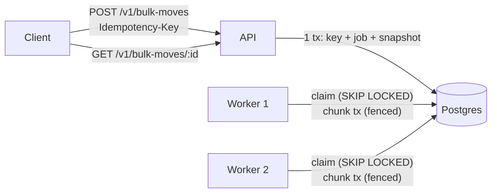

# DESIGN — Bulk Stage Move

A user picks a filter and moves up to 50,000 opportunities to another stage. The API answers
at once with a job id; workers do the moving in the background. **Postgres is the only state:**
the job table is the queue, the progress, the lease and the idempotency store. No worker keeps
anything in memory that matters, so any process can die at any moment.

## 1. Chunking, the cursor, and the index that makes it cheap

At submit, the matching set is frozen into `bulk_job_items(job_id, seq, opportunity_id,
snapshot_stage_id, snapshot_stage_rev)`, with `seq = row_number() OVER (ORDER BY id)`, so seq
runs 1..total with no gaps. The job row holds `cursor` = the last seq whose outcome is committed.

A worker processes one **chunk** (500 items) per transaction:

1. `SELECT … FROM bulk_jobs WHERE id = $1 AND lease_version = $fence FOR UPDATE`. The fence
   check: if another worker has claimed the job since, this matches nothing and we stop.
2. Take tokens from the workspace's bucket (§5).
3. Lock the chunk's opportunities: `bulk_job_items` with `seq IN (cursor, cursor+500]`, joined
   to `opportunities … FOR UPDATE OF o`, in id order.
4. Apply the collision rule (§3). Then, set-based: one `UPDATE` moves the unchanged rows, one
   `INSERT` writes their transitions, one `UPDATE` records every item's outcome.
5. Advance `cursor` and the counters, and set `completed` if `cursor = total`, still fenced.

All of that is **one commit**. So the cursor can never get ahead of the work, or fall behind it.
A crash before COMMIT rolls the chunk back. A crash after it leaves the cursor exactly at the
work done. "Resume" is simply the next claim reading `cursor` and carrying on.

**The index** is the primary key `(job_id, seq)`. Each chunk is a range scan
`seq > cursor ORDER BY seq LIMIT 500`, so chunk 100 costs the same as chunk 1. No OFFSET, no
scanning for "pending" rows.

**What "correct" means after a kill at 30,000 of 50,000:**
- every snapshot item ends with exactly one outcome;
- every `moved` deal is in the target stage, unless a human moved it again afterwards;
- each moved deal has exactly one `bulk` transition;
- `moved + skipped_conflict + skipped_noop = total`.

Exactly one transition is enforced by a unique index on `(bulk_job_id, opportunity_id)`. The
counter sum is a CHECK constraint on the job row, so it holds at every commit, not just at the end.

**What the user sees mid-way:** `processing`, `processed: 30000` and `percent: 60`, with the
30,000 moves already visible in the CRM. The rest are still in their old stage. Progress is read
from the committed row, so it never jumps backwards or lies after a restart. `health` explains
the pause: `running`, `throttled` (rate limit), `waiting` (between slices), `retrying` (backoff),
`stalled` (no live worker and no progress for 2× the lease), or `failed` (with a reason).

## 2. Idempotency model

- **Key:** the `Idempotency-Key` header (required), scoped per workspace:
  `PRIMARY KEY (workspace_id, key)`.
- **Stored:** in Postgres (`idempotency_keys`), in the same transaction as the job and its
  snapshot. It survives restarts, and the key, the job and the snapshot either all exist or none do.
- **How duplicates are handled:**
  - The key row is inserted **first**, `ON CONFLICT DO NOTHING`. A concurrent duplicate blocks on
    that unique index until the first transaction commits, then reads the winner's job.
  - Same key and same body (sha256 of the canonical request): `200` with the same `jobId`.
  - Same key and a different body: `422`.
  - **There is no 409 path at all**, including for duplicates that arrive together.
  - The job id is generated before the job row exists. The foreign key from the key to the job
    is `DEFERRABLE` so that order is allowed.
- **Inside the job:**
  - The fenced cursor makes a replayed chunk impossible.
  - The unique `(bulk_job_id, opportunity_id)` index makes a double transition impossible, even if
    a bug replayed a chunk.
  - `stage_rev` makes a double move impossible: a moved row has a new `stage_rev`, so a second
    attempt on it classifies as a conflict, not a move.
- **Where a retry can still slip through:**
  - **A client that sends the same intent with a *new* key** gets a second job. It cannot
    double-apply: every row the first job moved is now `skipped_noop` or `skipped_conflict`. But
    the user sees two jobs. Deriving a key from the body hash when the header is missing would
    narrow this; I chose to require the key instead.
  - **Keys never expire.** That is correct but grows forever. A TTL would re-open the "new job"
    case above after expiry.

## 3. Concurrency control on a single opportunity

- Every stage change bumps `opportunities.stage_rev` (optimistic version).
- The manual move takes `SELECT … FOR UPDATE` with `lock_timeout 1s`, retries once, and then
  returns 503 ("busy, retry").
- The bulk chunk locks its rows `FOR UPDATE`, in id order, for well under a second (500 rows,
  set-based statements).

When a manual move and the job hit the same record:

| Order of events | Result |
|---|---|
| Manual move commits **before** the chunk reaches the row | `stage_rev` differs from the snapshot, so the job records **`skipped_conflict`** and leaves the row alone. **The manual edit wins.** |
| Chunk holds the row lock when the manual move arrives | The manual move waits (milliseconds), then applies on top. Both are recorded in `stage_transitions`. The human acts last, so the human wins again. |
| Row is already in the target stage | `skipped_noop`. Nothing is written. |

**Why "manual wins":** the person moving one deal by hand is acting on newer information than
a filter they (or a colleague) ran minutes ago. Silently overwriting a deliberate edit is the
worst outcome for a CRM user. Every skipped row is listed at
`GET /v1/bulk-moves/:id/items?outcome=skipped_conflict`, so nothing is lost silently.

There is no deadlock risk. Manual moves lock a single row, and only one job per workspace runs
at a time, locking in a consistent order.

## 4. Snapshot vs live filter set

**Snapshot.** The set is fixed at submit time, and each item remembers the stage and `stage_rev`
it had then.

- **Why:**
  - A user who clicks "move these 12,431 deals" expects those deals moved, not whatever the
    filter matches minutes later.
  - It makes progress meaningful: `total` is fixed and `percent` is honest.
  - It makes the job finite and resumable by a simple cursor.
  - It is what lets us detect concurrent edits per row.
- **Consequences:**
  - A deal that starts matching the filter after submit is **not** moved. The user must run
    another bulk move.
  - A deal that stops matching because a human moved it is skipped as a conflict, not dragged along.
  - Submit costs one `INSERT … SELECT` of up to 50,000 rows inside the request (~0.5 s measured).
  - The 50k cap is checked with a bounded count (`LIMIT 50001`), then confirmed on the snapshot
    insert itself, because rows can appear between the two under READ COMMITTED.

## 5. Isolation mechanism, and the hole it still leaves

Four implemented mechanisms, each with a test or a benchmark:

1. **One processing job per workspace.** A partial unique index:
   `UNIQUE (workspace_id) WHERE status = 'processing'`. Two jobs in one tenant never fight over
   the same rows.
2. **Round-robin time slices.** A worker keeps a job for at most 2 s, then hands it back with
   `last_slice_at = now()`. The claim query orders by `last_slice_at NULLS FIRST`, so new and
   least-recently-served workspaces go first. A 50k job cannot hold a worker while a 50-row job
   in another workspace waits. *Test: with one worker, workspace B's small job completes while
   A's big job is still processing.*
3. **Per-workspace token bucket** (2,000 rows/s, burst 4,000). It lives on the workspace row and
   is taken inside the chunk transaction, so it holds across all workers and restarts, and tokens
   are only spent if the chunk commits. A throttled job yields its worker.
4. **Short, bounded transactions.** 500-row chunks, `lock_timeout` 2 s, `statement_timeout`
   10 s. The worker has its own 4-connection pool, so it can never take the API's connections.

**Measured** (BENCHMARKS.md): during a 50k move, list and manual-move p95/p99 in the same
workspace and in another one stayed close to the no-bulk baseline (p95 within about 4 ms,
p99 within about 17 ms), with 0 errors.

**The holes:**
- **The database is shared.** The bucket limits each tenant, not the sum. 50 tenants bulk-moving
  at once means 50 × 2,000 rows/s of writes on one Postgres, and only the worker count caps it.
  The next step is a global budget (a second bucket row) or worker concurrency per database shard.
- **Submit is not rate limited.** Many simultaneous 50k submits each do a 50k-row insert in the
  API process.
- **`stalled` can be wrong under a long queue.** A job waiting a long time for its next slice
  can show `stalled` when it is only waiting.

## 6. What breaks at 10× (a 500,000-row move, 20M opportunities in the workspace)

**First to fail: the synchronous snapshot at submit.** 500k rows in one request transaction
takes ~5–10 s, runs into the 30 s statement timeout under load, and holds a long transaction
that blocks vacuum. **Fix:** make the snapshot itself a job phase (`snapshotting`), filled by the
worker in id-range chunks from a consistent `REPEATABLE READ` export. Submit then only writes the
key and the job.

**Then:**
- **Filtering 20M rows.** The count and snapshot need indexes for the common filter combinations,
  e.g. `(workspace_id, owner_id, stage_id)`, and partitioning `opportunities` by workspace (hash)
  so one tenant's scans and vacuums don't touch the others.
- **`bulk_job_items` grows by 500k rows per job.** Partition it by job creation month and drop
  old partitions; keep only the counters on the job.
- **Write volume and table bloat.** 500k updates create 500k dead tuples. Tune autovacuum for
  `opportunities`, and pace with the bucket.
- **Duration.** 500k at 2,000 rows/s is about 4 minutes. That is acceptable for a background job,
  and the per-tenant rate should be a plan setting.

## 7. With another week (ranked)

1. **Asynchronous, chunked snapshot** (the 10× blocker above).
2. **Global write budget across tenants**, plus admission control on submit (the isolation hole).
3. **Outbox events** for moved deals (`opportunity.stage_changed`), written in the chunk
   transaction, so automations see exactly what committed.
4. **Cancel** (`POST /v1/bulk-moves/:id/cancel`): a fenced status flip checked at each chunk.
5. **Poison-row isolation.** If one row fails permanently, bisect the chunk, mark that item
   `failed_item` and continue, instead of failing the whole job.
6. **Metrics:** rows/s per workspace, queue age, lease takeovers, throttled time, and an alert on
   `stalled`.
7. Derived idempotency key when the header is missing, with a short TTL.
