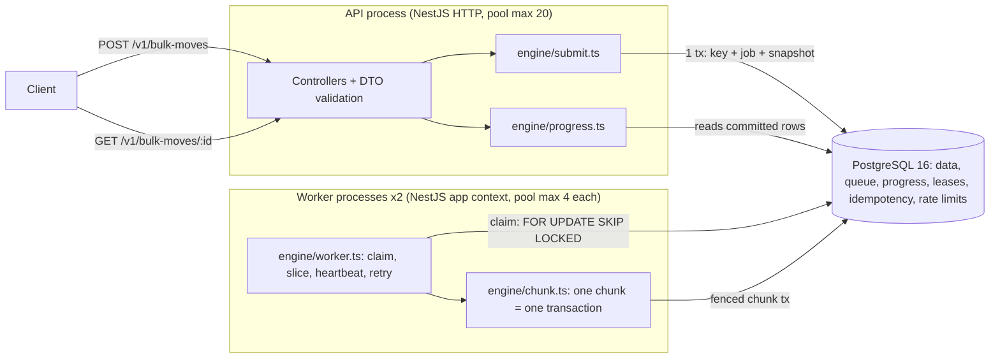
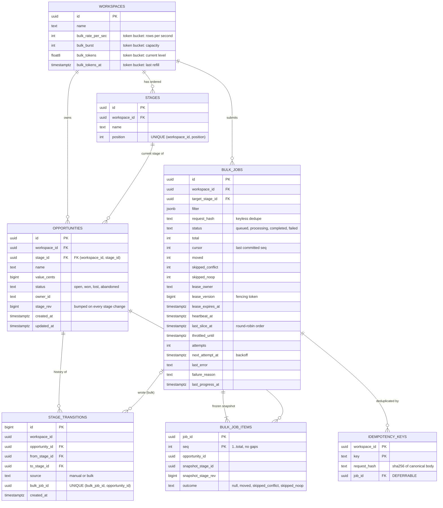
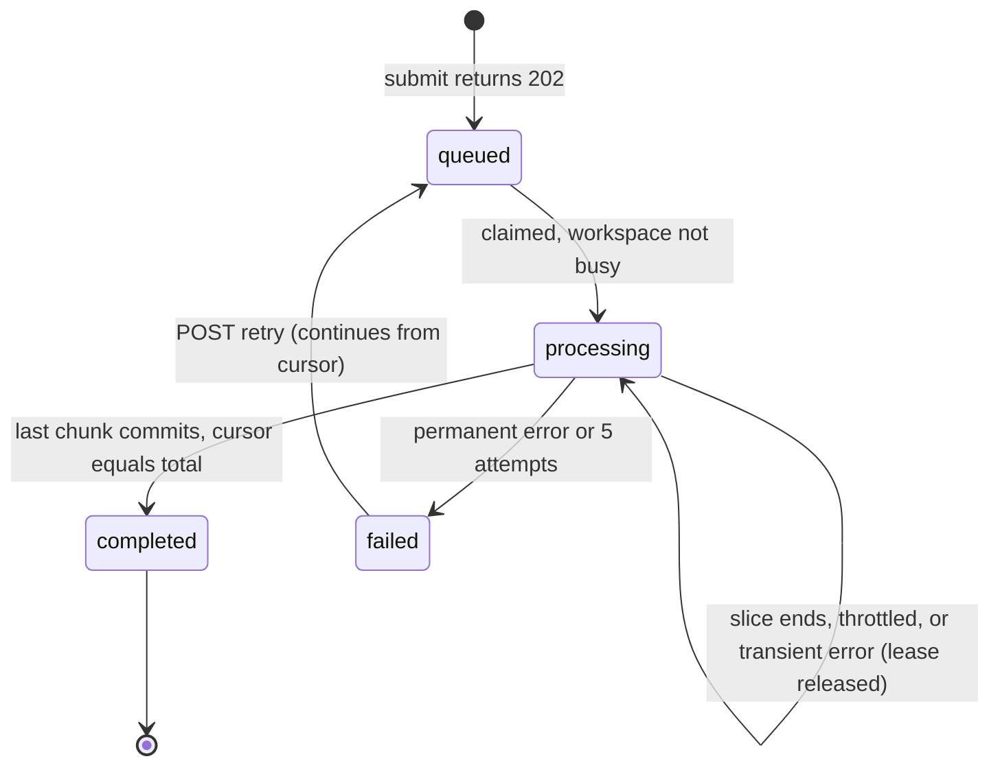
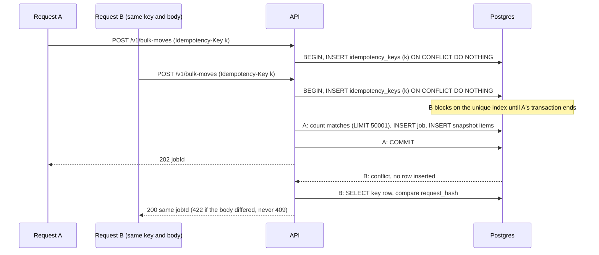
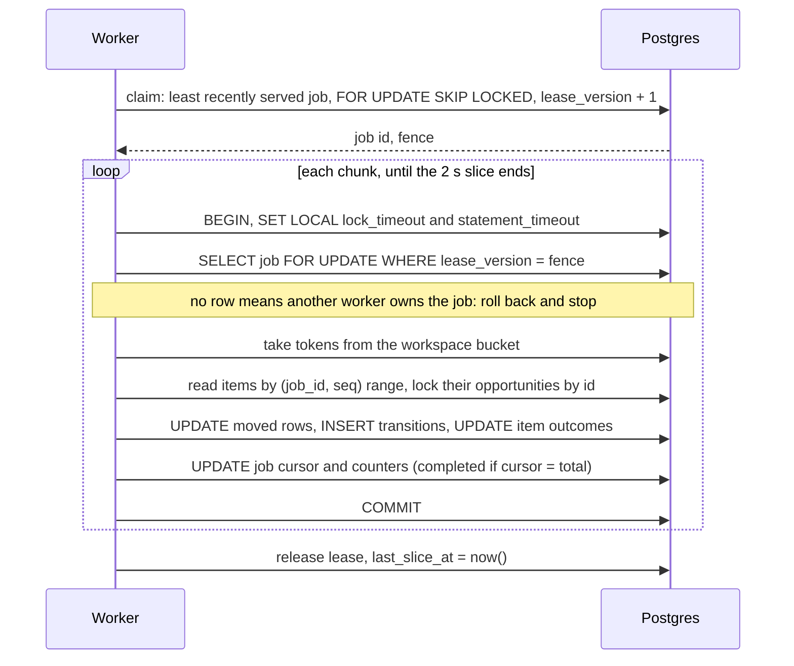
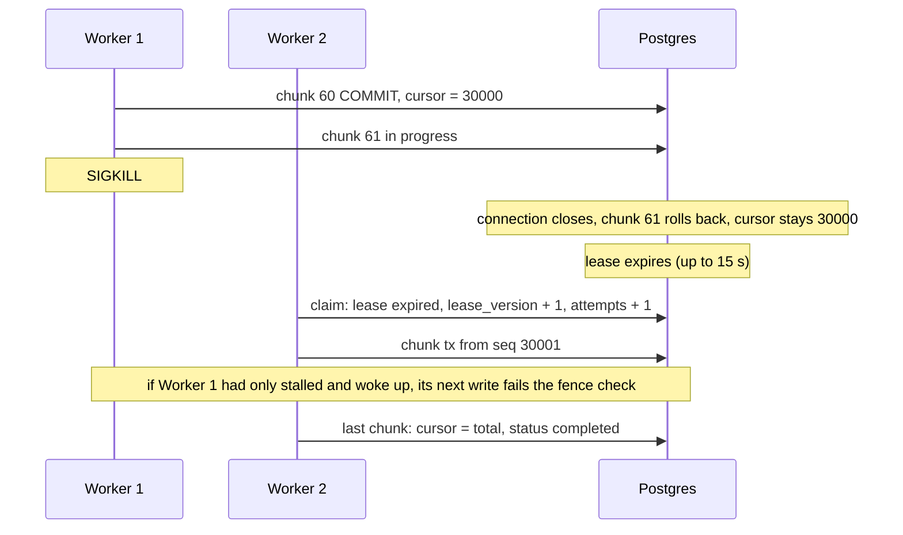
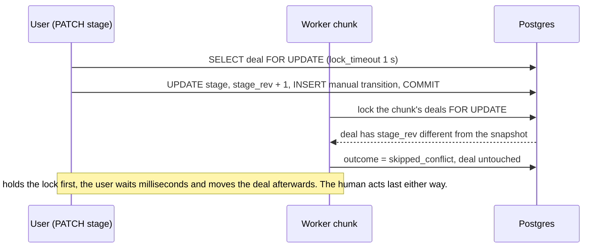

# Architecture

The diagrams and reference tables behind [DESIGN.md](../DESIGN.md). Every diagram here
matches the code (`src/engine/*`) and the schema (`migrations/*.sql`).

## 1. Components

There is no message broker. A job is a row: it commits in the same transaction that creates it,
and claiming it is a query. Nothing can be "lost in a queue".

## 2. Database schema

### Constraints that enforce correctness (not just documentation)

| Constraint | Table | What it guarantees |
|---|---|---|
| `CHECK (moved + skipped_conflict + skipped_noop = cursor)` | bulk_jobs | Progress can never drift from the work actually done |
| `CHECK (cursor BETWEEN 0 AND total)` and `CHECK (status <> 'completed' OR cursor = total)` | bulk_jobs | "Completed" is impossible before every item is processed |
| `UNIQUE (workspace_id) WHERE status = 'processing'` | bulk_jobs | One running job per workspace: two jobs never fight over a tenant's rows |
| `UNIQUE (bulk_job_id, opportunity_id) WHERE bulk_job_id IS NOT NULL` | stage_transitions | A job can never move the same deal twice |
| `PRIMARY KEY (workspace_id, key)` | idempotency_keys | One job per key per tenant; it is the lock for concurrent duplicates |
| Composite FKs `(workspace_id, stage_id) → stages (workspace_id, id)` | opportunities, transitions, jobs | Data can never point into another tenant |

### Indexes and why each exists

| Index | Used by |
|---|---|
| `bulk_job_items (job_id, seq)` (PK) | Every chunk: a range scan from the cursor. Chunk 100 costs the same as chunk 1. |
| `bulk_jobs (status, next_attempt_at) WHERE status IN ('queued','processing')` | The claim query only looks at unfinished jobs |
| `bulk_jobs (workspace_id) WHERE status = 'processing'` (unique) | Isolation rule above, and the claim's "workspace already busy?" check |
| `bulk_jobs (workspace_id, request_hash, created_at DESC)` | Keyless idempotency lookup |
| `opportunities (workspace_id, stage_id, created_at, id)` | Listing a stage (keyset pagination) and the bulk stage filter |
| `opportunities (workspace_id, owner_id)` / `(workspace_id, created_at)` | Bulk filters by owner and by date range |
| `stage_transitions (workspace_id, opportunity_id, created_at)` | A deal's history |

## 3. Job lifecycle

Once a job starts, it **stays `processing`** between time slices, rate-limit pauses and retries.
Only the lease is released. That prevents status flapping, and the unique index keeps a second
job in the same workspace from starting in a gap. Inside `processing`, the progress endpoint's
`health` field says what is happening:

| health | Condition (from committed columns, database clock) | Meaning for the user |
|---|---|---|
| `queued` | status = queued | Waiting for its first turn |
| `retrying` | attempts > 0 and next_attempt_at in the future | Transient error; retry scheduled |
| `throttled` | throttled_until in the future | Paused by the workspace rate limit: slow on purpose |
| `running` | lease_expires_at in the future | A worker is moving rows now |
| `waiting` | none of the above | Between slices: other workspaces are getting their turn (however long the queue) |
| `stalled` | lease still owned but expired over 5 s ago (worker died, nobody took over), or no committed progress for 5 min | Stuck: needs attention |
| `done` / `failed` | terminal status | Finished; `failureReason` explains a failure |

Each snapshot item ends with exactly one outcome:

| Current state of the deal when its chunk runs | Outcome |
|---|---|
| Already in the target stage | `skipped_noop` |
| Same stage **and** same `stage_rev` as at submit | `moved` (and one `bulk` transition) |
| Anything else (a human or an earlier job moved it) | `skipped_conflict`: the newer edit wins |

## 4. Sequence: submit (idempotent, also under concurrent duplicates)

Without a key, a transaction-scoped advisory lock on (workspace, request hash) plays the same
role as the key row.

## 5. Sequence: one worker slice

A heartbeat timer extends the lease, conditional on the fence. If tokens run out, the worker
releases the job early, sets `throttled_until`, and serves another workspace.

## 6. Sequence: crash and resume

## 7. Sequence: a manual move and the job hit the same deal

## 8. Locks, timeouts and pools

| Where | Setting | Why |
|---|---|---|
| Chunk transaction | `lock_timeout 2 s`, `statement_timeout 10 s`, 500 rows | Short, bounded transactions; row locks held well under a second |
| Manual move | `lock_timeout 1 s` + one retry, then `503` | An interactive request never waits behind bulk work for long |
| Submit | `statement_timeout 30 s` | Bounds the 50k snapshot insert |
| Lease / heartbeat | 15 s / 5 s | A dead worker's job is reclaimed within the lease time |
| Time slice | 2 s | Round-robin fairness between workspaces |
| Retries | backoff 0.5 s → 30 s with jitter, 5 attempts | Transient errors recover; a failure never loops forever |
| Pools | API 20, each worker 4 | Bulk work can never take the API's connections |
